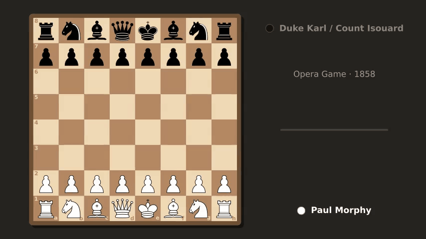
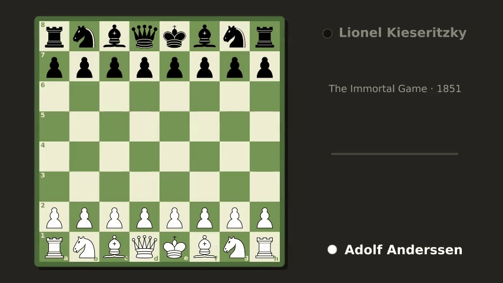
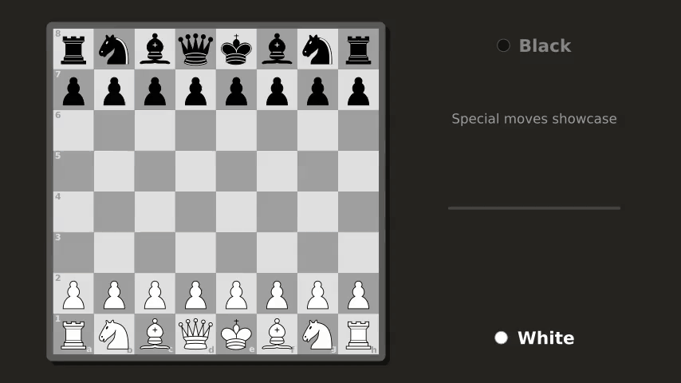

<div align="center">

# ♞ pgn_gif

**Turn any chess game in PGN notation into an animated GIF.**

[](https://github.com/Giordi9902/pgn_gif/actions/workflows/test.yml)
[](https://www.python.org/)
[](https://www.manim.community/)
[](LICENSE)



*The Opera Game — Paul Morphy vs. Duke Karl of Brunswick and Count Isouard, Paris 1858.*

</div>

---

## ✨ Features

- **One command, one GIF**: `pgn-gif game.pgn` and you're done.
- **Polished look**: Lichess-style vector pieces, framed board with drop shadow, coordinates inside the squares, last-move highlight and a red glow on a king in check.
- **4 themes**: `brown`, `green`, `blue`, `gray`.
- **Every rule covered**: captures, en passant, kingside and queenside castling, promotion (with capture too), all animated.
- **Info panel**: players (the side to move is highlighted), event and year, the move in SAN (`12. O-O-O`, `16... Nxb8`), a progress bar and the final result.
- **Small GIFs**: optimized ffmpeg conversion, **about 12× smaller** than Manim's own GIF output.
- **Fails fast**: a PGN with illegal moves is rejected with a clear message before any rendering starts.
- **Three ways to use it**: command line, Manim scene, Python function.
- **Tested**: 83 tests, from board geometry to full rendering, on Python 3.10–3.13.

## 🚀 Quick start

```bash
# 1. Manim's system dependencies (Debian/Ubuntu; see docs/usage.md for other systems)
sudo apt install libcairo2-dev libpango1.0-dev ffmpeg

# 2. Install
git clone https://github.com/Giordi9902/pgn_gif.git
cd pgn_gif
pip install .

# 3. Go!
pgn-gif examples/immortal_game.pgn
```

## 🎬 Gallery

<table>
  <tr>
    <td align="center"><br><b>The Immortal Game</b><br>Anderssen – Kieseritzky, 1851<br><code>--theme green</code></td>
    <td align="center"><br><b>The Evergreen Game</b><br>Anderssen – Dufresne, 1852<br><code>--theme blue</code></td>
  </tr>
  <tr>
    <td align="center" colspan="2"><br><b>Special moves</b><br>en passant · promotion with capture · queenside and kingside castling<br><code>--theme gray</code></td>
  </tr>
</table>

The source PGNs live in [`examples/`](examples/).

## 🛠️ Usage

### Command line

```text
pgn-gif [-h] [-o OUTPUT] [-q {l,m,h,k}] [-t MOVE_TIME] [--theme THEME] pgn
```

| Option            | Meaning                                          | Default                  |
|-------------------|--------------------------------------------------|--------------------------|
| `pgn`             | PGN file, or `-` to read from stdin              | —                        |
| `-o, --output`    | GIF to create                                    | PGN name with `.gif`     |
| `-q, --quality`   | `l` 480p · `m` 720p · `h` 1080p · `k` 4K         | `m`                      |
| `-t, --move-time` | seconds per ply                                  | `0.5`                    |
| `--theme`         | `brown` · `green` · `blue` · `gray`              | `brown`                  |

```bash
pgn-gif examples/evergreen_game.pgn -q h -t 1.5 --theme blue   # slow motion in full HD
curl -s https://lichess.org/game/export/<id> | pgn-gif - -o lichess.gif
```

### As a Manim scene

```bash
PGN_GIF_FILE=examples/opera_game.pgn PGN_GIF_THEME=green manim -qm --format=gif pgn_gif.py ChessGame
```

Without `PGN_GIF_FILE`, `game.pgn` in the current directory is used, falling back to the built-in Opera Game.

### From Python

```python
from pgn_gif import render_gif

render_gif(open("game.pgn").read(), "game.gif", quality="l", move_time=0.3, theme="green")
```

## 📚 Documentation

| Document                               | Contents                                                   |
|----------------------------------------|------------------------------------------------------------|
| [Usage guide](docs/usage.md)           | per-OS installation, every option, customization           |
| [How it works](docs/how_it_works.md)   | architecture, chess edge cases, GIF optimization           |
| [Contributing](CONTRIBUTING.md)        | development setup and guidelines                           |

## 🧪 Tests

```bash
pip install -e ".[dev]"
pytest                  # full suite (~10 s)
pytest -m "not slow"    # logic only, no rendering
```

One of the tests replays the animation plan of every example game and checks that the final position matches, piece by piece, the one computed by python-chess.

## 🗂️ Layout

```text
pgn_gif/
├── pgn_core.py        # pure logic: PGN parsing, move planning, themes, piece SVGs
├── pgn_gif.py         # Manim scene, rendering and command line
├── examples/          # sample PGN games
├── assets/            # GIFs rendered from the examples
├── docs/              # documentation
└── tests/             # pytest tests
```

## 📄 License

Released under the [MIT](LICENSE) license.

Built with [Manim Community](https://www.manim.community/) and [python-chess](https://python-chess.readthedocs.io/).
The pieces are Colin M.L. Burnett's set, generated on the fly by python-chess (they are not included in this repository).
