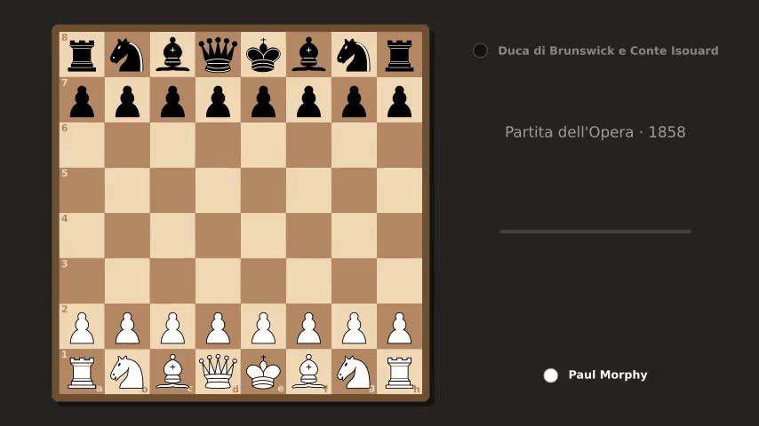
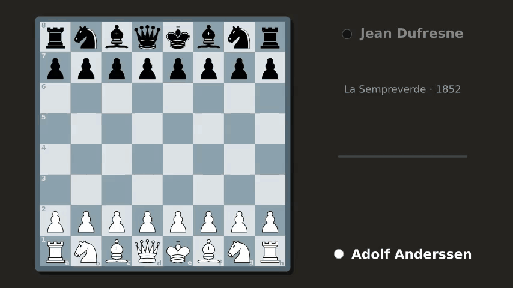
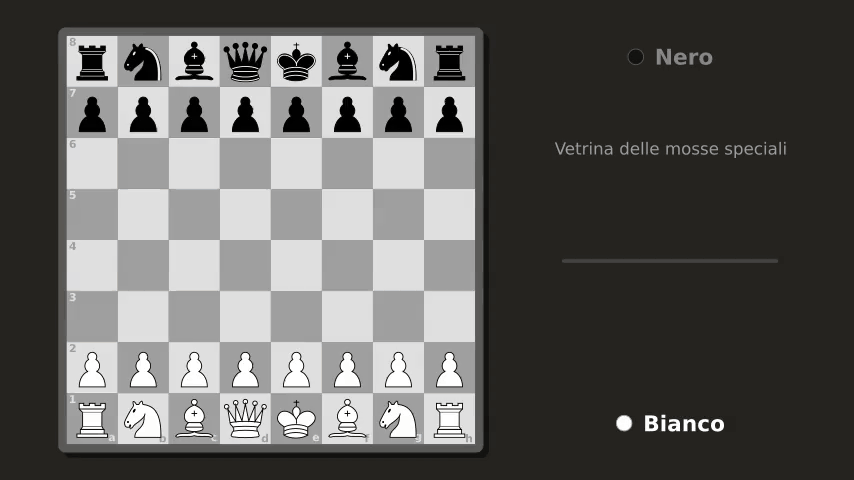

<div align="center">

# ♞ pgn_gif

**Trasforma qualsiasi partita di scacchi in notazione PGN in una GIF animata.**

[](https://github.com/Giordi9902/pgn_gif/actions/workflows/test.yml)
[](https://www.python.org/)
[](https://www.manim.community/)
[](LICENSE)



*La Partita dell'Opera — Morphy contro il Duca di Brunswick e il Conte Isouard, Parigi 1858.*

</div>

---

## ✨ Caratteristiche

- **Un comando, una GIF**: `pgn-gif partita.pgn` e hai finito.
- **Grafica curata**: pezzi vettoriali in stile Lichess, cornice con ombra, coordinate dentro le case, ultima mossa evidenziata e alone rosso sul re sotto scacco.
- **4 temi**: `marrone`, `verde`, `blu`, `grigio`.
- **Regole complete**: catture, en passant, arrocco corto e lungo, promozione (anche con cattura) — tutte animate.
- **Pannello informativo**: giocatori (con in evidenza chi deve muovere), evento e anno, mossa in notazione SAN (`12. O-O-O`, `16... Nxb8`), barra di avanzamento e risultato finale.
- **GIF leggere**: conversione ottimizzata con ffmpeg, **circa 12 volte più piccole** dell'output diretto di Manim.
- **Validazione in anticipo**: un PGN con mosse illegali viene rifiutato con un messaggio chiaro, prima di perdere tempo a renderizzare.
- **Tre modi di usarlo**: riga di comando, scena Manim, funzione Python.
- **Testato**: 83 test, dalla geometria della scacchiera al rendering completo, su Python 3.10–3.13.

## 🚀 Avvio rapido

```bash
# 1. Dipendenze di sistema di Manim (Debian/Ubuntu; per altri sistemi vedi docs/uso.md)
sudo apt install libcairo2-dev libpango1.0-dev ffmpeg

# 2. Installazione
git clone https://github.com/Giordi9902/pgn_gif.git
cd pgn_gif
pip install .

# 3. Via!
pgn-gif examples/immortale.pgn
```

## 🎬 Galleria

<table>
  <tr>
    <td align="center"><br><b>L'Immortale</b><br>Anderssen – Kieseritzky, 1851<br><code>--tema verde</code></td>
    <td align="center"><br><b>La Sempreverde</b><br>Anderssen – Dufresne, 1852<br><code>--tema blu</code></td>
  </tr>
  <tr>
    <td align="center" colspan="2"><br><b>Mosse speciali</b><br>en passant · promozione con cattura · arrocco lungo e corto<br><code>--tema grigio</code></td>
  </tr>
</table>

I PGN di partenza sono in [`examples/`](examples/).

## 🛠️ Uso

### Riga di comando

```text
pgn-gif [-h] [-o OUTPUT] [-q {l,m,h,k}] [-t TEMPO] [--tema TEMA] pgn
```

| Opzione         | Significato                                         | Predefinito             |
|-----------------|-----------------------------------------------------|-------------------------|
| `pgn`           | file PGN, oppure `-` per leggere da stdin           | —                       |
| `-o, --output`  | GIF da creare                                       | nome del PGN con `.gif` |
| `-q, --qualita` | `l` 480p · `m` 720p · `h` 1080p · `k` 4K            | `m`                     |
| `-t, --tempo`   | secondi per semimossa                               | `0.5`                   |
| `--tema`        | `marrone` · `verde` · `blu` · `grigio`              | `marrone`               |

```bash
pgn-gif examples/sempreverde.pgn -q h -t 1.5 --tema blu   # moviola in alta definizione
curl -s https://lichess.org/game/export/<id> | pgn-gif - -o lichess.gif
```

### Come scena Manim

```bash
PGN_GIF_FILE=examples/opera.pgn PGN_GIF_TEMA=verde manim -qm --format=gif pgn_gif.py PartitaPGN
```

Senza `PGN_GIF_FILE` viene usato `partita.pgn` della cartella corrente, oppure la Partita dell'Opera incorporata.

### Da Python

```python
from pgn_gif import renderizza

renderizza(open("partita.pgn").read(), "partita.gif", qualita="l", tempo_mossa=0.3, tema="verde")
```

## 📚 Documentazione

| Documento                                      | Contenuto                                                  |
|------------------------------------------------|------------------------------------------------------------|
| [Guida all'uso](docs/uso.md)                   | installazione per sistema, tutte le opzioni, personalizzazione |
| [Come funziona](docs/come_funziona.md)         | architettura, casi speciali degli scacchi, ottimizzazione GIF |
| [Contribuire](CONTRIBUTING.md)                 | ambiente di sviluppo e linee guida                         |

## 🧪 Test

```bash
pip install -e ".[dev]"
pytest                  # suite completa (~10 s)
pytest -m "not slow"    # solo la logica, senza renderizzare
```

Tra i test c'è una simulazione che riapplica il piano di animazione di ogni partita d'esempio e verifica che la posizione finale coincida, pezzo per pezzo, con quella calcolata da python-chess.

## 🗂️ Struttura

```text
pgn_gif/
├── pgn_core.py        # logica pura: lettura PGN, piano delle mosse, temi, SVG dei pezzi
├── pgn_gif.py         # scena Manim, rendering e riga di comando
├── examples/          # partite PGN d'esempio
├── assets/            # GIF generate dagli esempi
├── docs/              # documentazione
└── tests/             # test pytest
```

## 📄 Licenza

Distribuito con licenza [MIT](LICENSE).

Costruito con [Manim Community](https://www.manim.community/) e [python-chess](https://python-chess.readthedocs.io/).
I pezzi sono quelli di Colin M.L. Burnett, generati al momento da python-chess (non sono inclusi nel repository).
